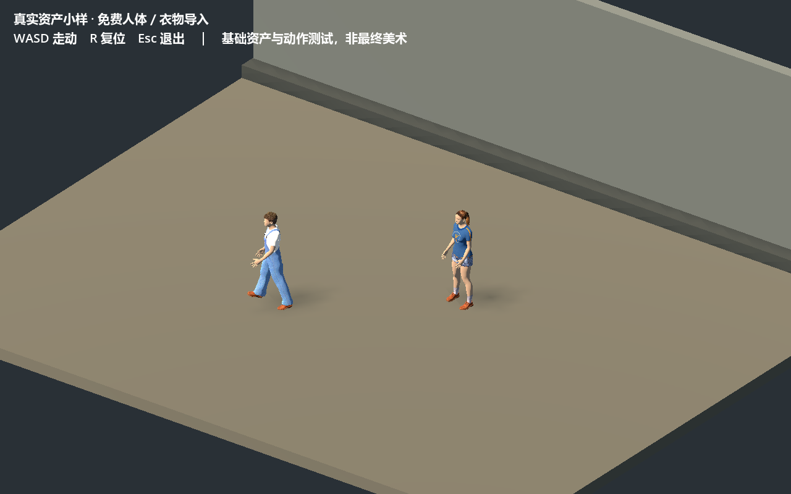
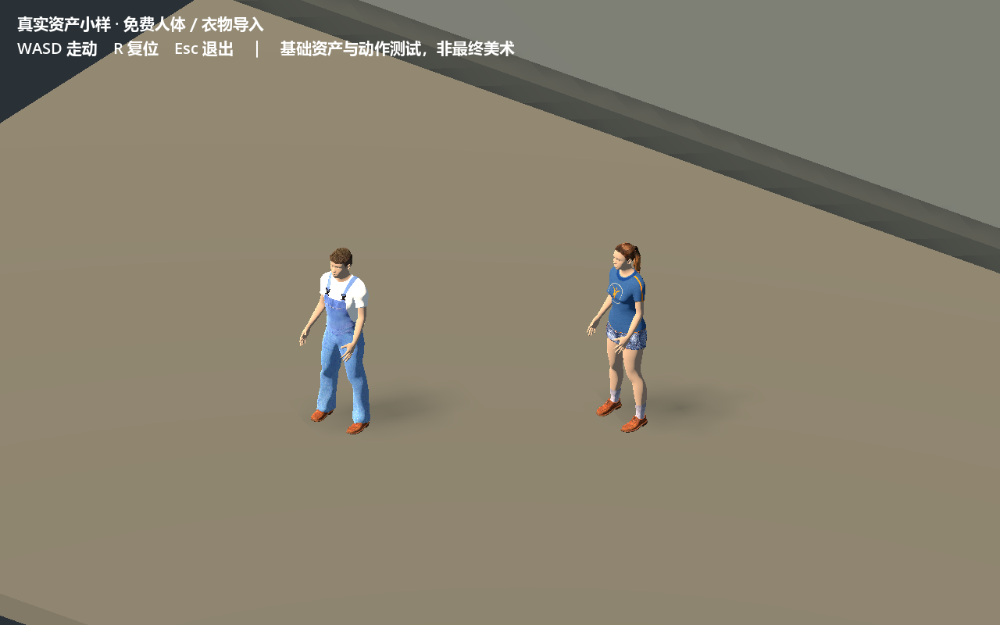

# V0真实资产小样

状态：有限资产接入已验证，整体风格仍未成立。依据Owner已采用《极乐迪斯科》参照、否定概念图可达性承诺并要求继续执行。本轮是有限模型/材料实机适配，不是V1玛丽生产或V2正式人物戏。

五项需求：

1. PLAYER NEED：正常游玩距离需要能读出人体、衣物和生活空间；现有球头方块不能回答采用参照是否可制作。
2. NARRATIVE / GAMEPLAY CONTEXT：当前首见POC的母亲/主角同场标准；只验证自然比例和材料，不新增剧情、人物身份、机械结构或正式表演。
3. MINIMUM IMPLEMENTATION：直接复用免费成熟人体/衣物资源，经现有Blender导出glTF，在Godot检查正常距离、材质、比例、遮挡与基础走动可读性。只取有限依赖，保存可编辑源、导出和许可；原可玩工程及其输入/镜头不被临时小样覆盖。
4. WHY NOT LESS：概念图不证明3D资产可编辑/可导入；给当前几何人物换色也不证明自然衣物轮廓。优先成熟资源，避免从零造人体、绑定、衣物适配或渲染器。
5. LEGACY DEPENDENCY：NONE。

取舍：Quaternius Universal Base Characters免费Standard包实际仅有Superhero男女体型，缺少Regular，因此本轮不采用。转用MakeHuman/MPFB成熟人体与CC0核心生活服装；工具源代码GPL/AGPL与产出/核心资产CC0须分开。使用本机Blender，兼容版本和实际结果在完成后填写。免费资源只用于小样，不把默认外观当成正式母亲/主角。

本页不是native TASK/READY，亦不裁定路线或艺术验收。具体成本指实际依赖、修改和运行发现，不给概念图编造资产预算。

## 实际复用和结果

使用Blender 3.5.1 + MPFB v2.0-a3/077d44f，未升级Blender或安装用户插件。两份GLB各保留53骨骼；成年试件30,590三角形/17,423,404字节，女性试件33,188三角形/13,331,564字节，每份5网格/5内嵌图。数值直接读GLB访问器，不能用包含辅助面的Blender源统计替代。资产许可与具体文件见[来源](../../pocs/stylized_3d/visual_v0/third_party/makehuman/README.md)，[可重复导出](../../tools/style_sample/README.md)及两个可编辑源`.local/people-build-04/*.blend`已保留。

直接调用MPFB `HumanService.create_human`、`add_builtin_rig`、`add_mhclo_asset`及`RigService.apply_pose_as_rest_pose`，人体拓扑、衣物贴合、遮蔽、绑定与权重没有重写。Godot使用原`human.gd`的碰撞/步行/朝向，局部适配四根导入骨骼；未自建动画/角色框架。采用Godot原生glTF内嵌贴图导入，不重复提交自动解出的PNG。

运行`visual_v0`中的`asset_sample.tscn`即可WASD走动、R复位、Esc退出；原默认首见入口未改。正常视距为7.5m正交取景（人物约150px高）；5m仅作细节诊断。不是正式摄影方案。

Godot 4.7.1 Compatibility真实渲染：33项/0失败，含两份骨骼、站姿头脚高度、屏幕A左/D右、实体移动、复位及三帧保存。最后导入/运行stderr无ERROR；[日志](real_asset_sample/smoke-final.log)。检查仅覆盖小样，原首见代码未变，不重复全轮哈希或称原剧情已回归。人工体验L5未测。

## 失败与未解决的问题

- 第一次导出调用Blender addon接口参数错误；第二次缺可选brown眼睛材料。已改为正确接口/简单眼睛材质，失败日志保留本机，不伪称首次成功。
- 第一轮输入21/0但腿部翻折，图像检查判FAIL。原因是直接覆盖导入骨骼原有pose rotation，改为原姿态叠加后消失，并增加站姿头/脚高度检查；[失败帧](real_asset_sample/failure_folded_legs.png)保留。逻辑绿不等于形变正常。
- 切换内嵌纹理时，旧缓存尝试引用已移走的自动解出纹理UID而报ERROR；完成资源重新导入/再扫描后消失。最终无该错误，旧日志留`.local/asset-import-embedded.err`。
- 默认现代蓝色服装/橙鞋不适合作为正式人物；牛仔高频图案在正常距离仍显碎。贴图只降高光/禁法线，没有得到参照的绘画表面。动作仍是POC四肢摆动，缺膝关节/重心/成熟步行循环，不能作为人物表演。
- 背景仍是简单测试地墙，没有正式环境资产；这次证明可复用人体/衣物能实际接入，未证明《极乐迪斯科》式最终画质。后续首先筛适合年代/轮廓的衣物和可复用动作，调整实际材料大面；不再以概念图宣称可达性。
